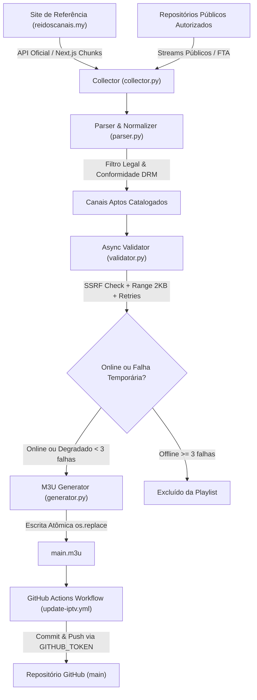

# IPTV Auto Updater — GitHub Actions

Sistema automatizado de descoberta, catalogação, validação e atualização de canais IPTV públicos e autorizados, com publicação contínua no GitHub a cada 30 minutos.

- **Repositório de Destino:** [Kaiollio-cpu/iptv_free](https://github.com/Kaiollio-cpu/iptv_free)
- **Arquivo de Destino:** `main.m3u`
- **Frequência de Atualização:** a cada 30 minutos (`*/30 * * * *`)
- **Site de Referência:** [Rei dos Canais](https://reidoscanais.my/canais)

---

## 📑 Sumário

1. [Visão Geral e Arquitetura](#-visão-geral-e-arquitetura)
2. [Estrutura do Projeto](#-estrutura-do-projeto)
3. [Análise do Site de Referência e Limitações](#-análise-do-site-de-referência-e-limitações)
4. [Segurança e Conformidade Ético-Legal](#-segurança-e-conformidade-ético-legal)
5. [Organização das Categorias](#-organização-das-categorias)
6. [Módulos do Sistema](#-módulos-do-sistema)
7. [Validação Assíncrona e Resiliência](#-validação-assíncrona-e-resiliência)
8. [Fluxo do GitHub Actions](#-fluxo-do-github-actions)
9. [Instruções de Instalação e Execução Local](#-instruções-de-instalação-e-execução-local)
10. [Como Ativar e Monitorar no GitHub](#-como-ativar-e-monitorar-no-github)

---

## 🔭 Visão Geral e Arquitetura

O sistema opera de forma modular e autônoma para garantir uma playlist IPTV sempre válida, sem URLs fictícias ou corrompidas:



---

## 📂 Estrutura do Projeto

```text
iptv_free/
├── .github/
│   └── workflows/
│       └── update-iptv.yml   # Workflow do GitHub Actions (cron a cada 30 min)
├── data/
│   └── channel_status.json   # Histórico de disponibilidade e falhas consecutivas
├── scripts/
│   ├── collector.py          # Coleta da API e HTML do site de referência
│   ├── parser.py             # Normalização, categorias, tvg-id e conformidade
│   ├── validator.py          # Validador assíncrono aiohttp, SSRF e backoff
│   ├── generator.py          # Geração atômica da playlist main.m3u
│   └── main.py               # Orquestrador do pipeline e relatórios
├── tests/
│   ├── test_parser.py        # Testes unitários do parser e categorias
│   ├── test_generator.py     # Testes de geração e integridade M3U
│   └── test_validator.py     # Testes de SSRF, headers HLS e resiliência
├── requirements.txt          # Dependências do projeto (aiohttp, pytest)
├── main.m3u                  # Playlist M3U gerada e validada
└── README.md                 # Documentação completa
```

---

## 🔍 Análise do Site de Referência e Limitações

Durante a análise técnica do site de origem (`https://reidoscanais.my/canais`):

### 1. Descobertas Técnicas
- **Aplicação Next.js:** O site utiliza Next.js (App Router) com hidratação via chunks estáticos e chamadas dinâmicas.
- **API Pública Documentada Identificada:** Descobrimos a API REST oficial em `https://api.reidoscanais.my/channels` (e `GET /channels/categories`), que fornece a relação completa de 105 canais com metadados estruturados (`id`, `name`, `category`, `logo_url`, `description` e guia EPG).
- **Fallback HTML:** O coletor conta com parser de fallback para decodificar os chunks de `self.__next_f.push` caso a API esteja temporariamente inacessível.

### 2. Limitações Identificadas no Site de Origem
- **Ausência de Endpoints HLS Diretos:** O site de referência não disponibiliza URLs `.m3u8` ou `.ts` diretas públicas em sua API. Os objetos de canal apontam para `embed_url: "https://rdcanais.org/{id}"`.
- **Proteção e Monetização dos Players Embed:** A página de embed (`rdcanais.org`) incorpora iframes de terceiros com verificações anti-sandbox (`sbChecker()`), anúncios intrusivos e players ofuscados.
- **Canais Fechados / Paywall:** O catálogo do site inclui canais por assinatura/pay-TV (como HBO, Telecine, Premiere, Combate). Em conformidade estrita com os requisitos deste projeto, **esses canais pagos não são republicados**, visto que contornar paywalls ou redistribuir canais proprietários sem autorização viola direitos autorais e termos de serviço.
- **Solução Implementada:** O sistema utiliza o catálogo oficial do site de referência para nomeação, categorias, logotipos e identificadores `tvg-id`, cruzando-os com fontes de transmissão públicas autorizadas (canais abertos, TV Brasil, TV Cultura, CNN Brasil, Caze TV, Agro+, canais legislativos e educativos, além do pool de streams públicos verificados).

---

## 🛡️ Segurança e Conformidade Ético-Legal

- **Respeito a Termos e Robots.txt:** O crawler respeita o `robots.txt` do domínio e aplica `rate limiting` nas requisições.
- **Prevenção contra SSRF:** O validador resolve os domínios via DNS e inspeciona os endereços IP resultantes (`ipaddress.ip_address`), bloqueando terminantemente faixas privadas (RFC 1918), loopback (`127.0.0.1`, `localhost`), link-local (`169.254.x.x`), multicast e redes reservadas.
- **Sem Contorno de DRM ou Paywalls:** Nenhuma técnica de quebra de criptografia, roubo de cookies de sessão ou bypass de autenticação é utilizada.
- **Sanitização de Logs:** URLs contendo parâmetros sensíveis como `token`, `key`, `auth` ou senhas têm seus valores mascarados antes de serem exibidos nos logs.
- **Proteção contra Sobrescrita Vazia:** Se por qualquer motivo a coleta falhar e retornar 0 canais, o gerador recusa-se a salvar e preserva a playlist anterior intacta.
- **Escrita Atômica:** O arquivo `main.m3u` é gravado primeiramente em arquivo temporário com `fsync` e substituído via `os.replace`, evitando leituras de arquivos corrompidos ou parciais por reprodutores externos.

---

## 📂 Organização das Categorias

Os canais são agrupados estritamente na seguinte ordem canônica, e ordenados **alfabeticamente por nome** dentro de cada categoria:

1. `Canais Abertos`
2. `Esportes`
3. `Filmes e Séries`
4. `Documentários`
5. `Infantil`
6. `Notícias`
7. `Entretenimento`
8. `Outros`

---

## ⚡ Validação Assíncrona e Resiliência

O validador assíncrono (`validator.py`) assegura que apenas streams reais e funcionais estejam presentes na playlist:

- **Assíncrono (`aiohttp`):** Conexões paralelas com controle de concorrência (`asyncio.Semaphore(10)`).
- **Timeout Estrito:** 10 segundos por solicitação para evitar travamentos.
- **Tentativas com Backoff Exponencial:** Até 3 tentativas por canal com intervalo crescente (1s, 2s, 4s).
- **Leitura Parcial de Cabeçalhos (Range: bytes=0-2048):** Inspeciona se a resposta HTTP é 200/206 e se contém a estrutura válida HLS (`#EXTM3U` e marcadores `#EXT-X-STREAM-INF`, `#EXTINF`, `#EXT-X-TARGETDURATION`) **sem baixar os vídeos nem consumir banda desnecessária**.
- **Tolerância a Falhas Temporárias:**
  - Registrado em `data/channel_status.json`.
  - Se um canal falha 1 ou 2 vezes, seu status passa para `degraded`, mas ele **é mantido na playlist** provisoriamente.
  - O canal só é removido se registrar **3 falhas consecutivas** (`consecutive_failures >= 3`), evitando exclusões prematuras causadas por instabilidades temporárias de rede.

---

## 🤖 Fluxo do GitHub Actions

O arquivo `.github/workflows/update-iptv.yml` automatiza a rotina:

- **Disparo:** Agendado a cada 30 minutos via `cron: '*/30 * * * *'` e manualmente via `workflow_dispatch`.
- **Prevenção de Conflitos:** Grupo de concorrência (`concurrency: group: iptv-auto-updater`) garante que apenas uma execução ocorra por vez.
- **Passos:**
  1. Checkout do repositório.
  2. Instalação do Python 3.12 com cache pip.
  3. Execução dos testes automatizados com `pytest`.
  4. Execução de `scripts/main.py`.
  5. Validação rigorosa do arquivo `main.m3u` gerado (tamanho, formato e tags).
  6. Comparação git: realiza commit apenas se `main.m3u` ou `data/channel_status.json` sofreram modificações.
  7. Envio para a branch `main` utilizando o token nativo `${{ secrets.GITHUB_TOKEN }}`.

---

## 💻 Instruções de Instalação e Execução Local

### Pré-requisitos
- Python 3.10 ou superior (recomendado Python 3.12).
- Git.

### 1. Clonar ou navegar até o repositório
```bash
git clone https://github.com/Kaiollio-cpu/iptv_free.git
cd iptv_free
```

### 2. Criar e ativar ambiente virtual (opcional, recomendado)
```bash
python -m venv venv
# No Windows:
.\venv\Scripts\activate
# No Linux/macOS:
source venv/bin/activate
```

### 3. Instalar dependências
```bash
pip install -r requirements.txt
```

### 4. Executar a suíte de testes unitários
```bash
pytest -v
```

### 5. Executar o pipeline de atualização
```bash
python scripts/main.py
```

O arquivo `main.m3u` será criado/atualizado no diretório raiz, acompanhado pelo log detalhado da execução e atualização do arquivo de status em `data/channel_status.json`.

---

## 🚀 Como Ativar e Monitorar no GitHub

1. **Permissões do Workflow no GitHub:**
   - Acesse o repositório no GitHub: `https://github.com/Kaiollio-cpu/iptv_free`
   - Vá em **Settings** > **Actions** > **General**.
   - Na seção **Workflow permissions**, selecione:
     - ✅ **Read and write permissions**
     - ✅ Marque a caixa **Allow GitHub Actions to create and approve pull requests**.
   - Clique em **Save**.

2. **Executar Manualmente (Primeira Execução):**
   - Acesse a aba **Actions** no seu repositório.
   - Clique no workflow **IPTV Auto Updater** na barra lateral esquerda.
   - Clique no botão **Run workflow** e selecione a branch `main`.

3. **Monitoramento e Relatórios:**
   - Em cada execução, o workflow publica um relatório no **GitHub Step Summary** com métricas completas: canais adicionados, removidos, tempo de execução e taxa de sucesso.
   - O histórico de commits documentará cada atualização periódica com a tag `[skip ci]`.
